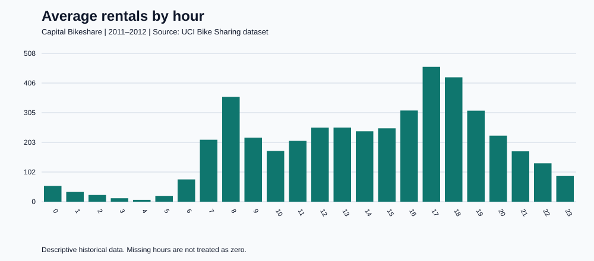
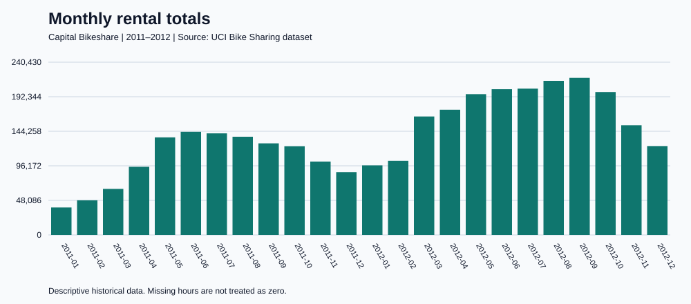

# Bike Rental Demand Analysis with PySpark SQL

A beginner-friendly data engineering and SQL portfolio project using real Capital Bikeshare observations from Washington, D.C., in 2011–2012.

**Business question:** When is rental demand highest, and how does it vary by month, working day, and weather?

## What this project demonstrates

- Downloading a public dataset reproducibly.
- Reading CSV data with an explicit Spark schema.
- Validating rental counts and checking duplicate date/hour pairs.
- Creating a temporary SQL view and running SQL files.
- Aggregations, CASE, joins, common table expressions, and LAG window functions.
- Exporting small analysis results as CSV and JSON.

This dataset fits in memory. Spark is used to practise a pipeline that can later be adapted to larger data; distributed computing is not necessary for this sample.

## Run on Windows PowerShell

PowerShell launches Python. Python creates Spark, and Spark executes SQL. Enter these commands at a PowerShell prompt, not the Python `>>>` prompt.

From the project directory:

```powershell
python -m pip install -r requirements.txt
python src/download_data.py
python -u src/analyze.py
```

The local starter folder includes the data. GitHub excludes raw files; run the download command after cloning the repository. Java 17 must be available through `JAVA_HOME` or your command path. This project pins PySpark 4.2.0 to match the author's learning environment.

The script sets `PYSPARK_PYTHON` to the active Python executable, addressing the Windows `Cannot run program python3` error. Results go into `reports/`. They are regenerated on each successful run. Do not use older reports as evidence of a failed run.

## Project layout

```text
src/download_data.py    Download public source files
src/analyze.py          Validate data and execute SQL
sql/                   Six commented analysis queries
data/raw/              Original UCI CSV files and source Readme
reports/               Generated CSV and JSON summaries
EXERCISES.md           Tasks to extend the analysis
DATA_SOURCE.md         Attribution and interpretation notes
```

## Analyses

| SQL file | Question |
| --- | --- |
| 01_overview.sql | How many rentals and observed hours are present? |
| 02_monthly_trend.sql | How does demand change over time? |
| 03_peak_hours.sql | Which hours have the greatest average demand? |
| 04_working_days.sql | How do hourly patterns differ by day type? |
| 05_weather.sql | What demand is observed under each weather category? |
| 06_monthly_growth.sql | How much do monthly totals change? |

## Results





The completed Spark analysis found **17,379 hourly observations** and **3,292,679 rentals**, matching an independent Python CSV check. The three busiest hours by average observed rental count were **17:00 (461.45)**, **18:00 (425.51)**, and **08:00 (359.01)**. These are descriptive observations, not forecasts. See `reports/VALIDATION.md` for validation details.

The evening and morning peaks suggest investigating commuting demand. Operational decisions would require current data, station locations, bike availability, and further analysis.

## Limitations

- Historical observations describe 2011–2012, not present-day demand.
- One row is an aggregated hour; it contains no individual trip or station information.
- Missing hours are not filled with zero. Averages use observed hours and expose their counts.
- Working day excludes both weekends and holidays.
- Weather averages show association; they do not establish causation. Hour and season may explain some differences.
- Rare weather categories can have very small samples; inspect observation counts before comparing them.
- Monthly totals depend on month length and available hours; the monthly table also includes average hourly demand.
- Temporary views disappear when Spark stops. CSV and JSON reports persist.

## Publishing on GitHub

Create an empty repository named `spark-bike-demand`. The GitHub website's **Add file → Upload files** can upload these project files. Preserve the folder structure and include source attribution. Alternatively, with Git installed:

```powershell
git init
git add .
git commit -m "Add bike rental demand analysis with PySpark SQL"
git branch -M main
# Replace the URL below with your actual repository URL.
git remote add origin https://github.com/YOUR_USERNAME/spark-bike-demand.git
git push -u origin main
```

The public dataset is CC BY 4.0; see DATA_SOURCE.md. No separate software license has been selected for this project's code.
